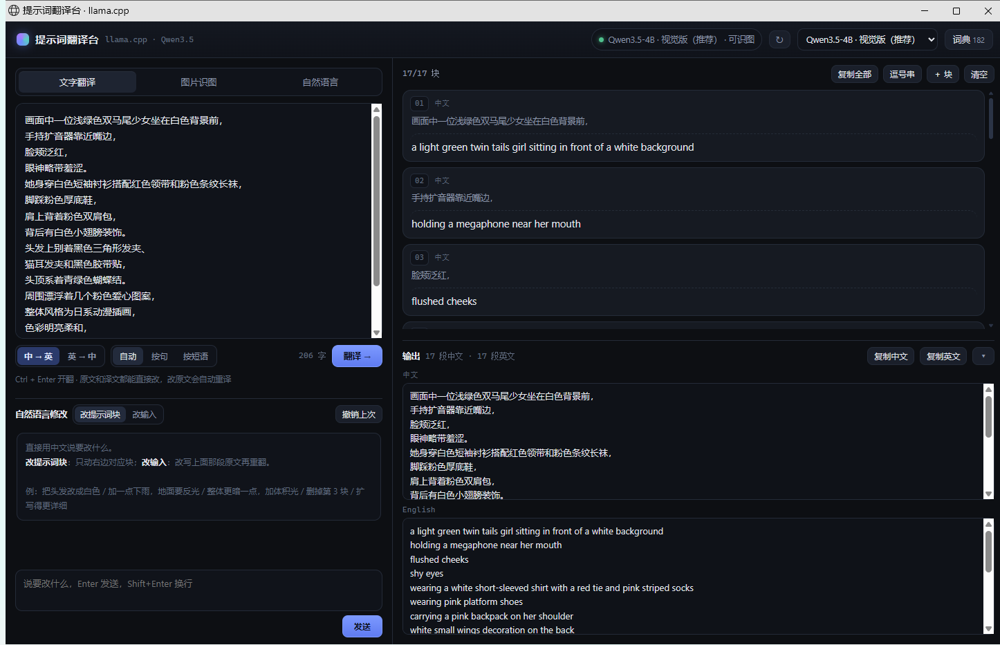
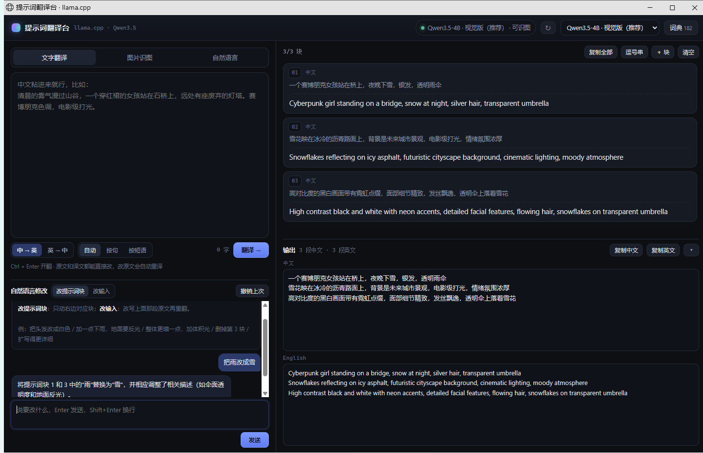

# 提示词翻译台 · llama.cpp

纯本地的中译英工作台，给 AI 绘画 / 影像提示词用。中文进来，英文出去，**一句一块**，能单独改、单独重译、单独复制。也可以丢一张图进去让模型自己写，或者用中文直接说需求让它生成。

不联网，不上传，全在本机 GPU 上跑。



---

## 下载 / 两种分发

| 版本 | 内容 | 大小 | 从哪拿 |
|---|---|---|---|
| **lite** | 程序 + 自带 Node 运行时 + 桌面启动器；**不含** llama.cpp 和模型 | ~90 MB | [Releases](https://github.com/MJDACK/llama-translate/releases) 里的 `llama-translate-lite-win64.zip` |
| **full** | 程序 + llama.cpp（CUDA 12.4）+ 四个 Qwen3.5 模型 | ~13 GB | 超过 GitHub 单文件 2 GB 限制，不在 Release 里；用 `tools\build-full.ps1` 自己打，或由作者另行分发（网盘） |

lite 解压后还不能直接用，要先把 llama.cpp 和模型放进去（见下一节）。full 是解压即用。

## lite 怎么补齐依赖

1. 解压到一个**英文路径**（中文路径也能跑，程序会自动处理，但英文省事）。
2. 下载 llama.cpp 的 Windows CUDA 版（release 里的 `llama-bXXXX-bin-win-cuda-12.4-x64.zip`），解压到 `llama.cpp\`，确保里面有 `llama-server.exe`。
3. 再放 CUDA 运行时：从 `cudart-llama-bin-win-cuda-12.4-x64.zip` 里把 `cudart64_12.dll`、`cublas64_12.dll`、`cublasLt64_12.dll` 拷进 `llama.cpp\`。**缺了这三个 DLL，CUDA 后端会静默退回 CPU**，速度差 5 倍。
4. 把 gguf 模型放进 `models\`，例如：

   ```
   models\qwen4B\Qwen3.5-4B-Uncensored-HauhauCS-Aggressive-Q4_K_M.gguf
   models\qwen4B\mmproj-Qwen3.5-4B-Uncensored-HauhauCS-Aggressive-BF16.gguf
   ```

   模型文件名要和 `config.json` 里对得上；换名字就改 config。模型是社区合并版（Qwen3.5 + HauhauCS Aggressive），在 Hugging Face / ModelScope 搜同名文件能找到；只有文本的 gguf 也能用，把 `mmproj` 留空即可（识图会标成不可用）。
5. 双击 `提示词翻译台.exe`。

## 怎么打包分发

仓库里的 `tools\` 有两个脚本，跑在 Windows PowerShell 5.1+ 上，产物在 `dist\`：

```powershell
# 不带 llama.cpp / 模型，约 90 MB
powershell -ExecutionPolicy Bypass -File tools\build-lite.ps1

# 带 llama.cpp + 模型，约 13 GB（-LlamaDir / -ModelsDir 指向你的目录）
powershell -ExecutionPolicy Bypass -File tools\build-full.ps1 -LlamaDir D:\llama-translate\llama.cpp -ModelsDir D:\llama-translate\models
```

`-NodeExe` 可以指定 node.exe；不给就用仓库旁边的 `runtime\node.exe` 或系统 PATH 里的 node。

## 从源码运行

```powershell
node server.js
```

需要 Node 18+（或用 `runtime\node.exe`），`config.json` 里指向的 `llama.cpp` 和 `models` 要存在。桌面启动器 `提示词翻译台.exe` 编译自 `Launcher.cs`：

```powershell
csc /target:winexe /out:提示词翻译台.exe /win32icon:app.ico Launcher.cs
```

---

## 怎么用

**桌面版（推荐）**：双击 **`提示词翻译台.exe`**。它会自己拉起服务，弹一个独立窗口（没有地址栏、没有标签页）。**关掉这个窗口就是退出程序**，后台的 node 和 llama-server 会一起收干净，不留渣。

想要桌面图标：双击 **`创建桌面快捷方式.bat`**，桌面就会出现「提示词翻译台」。

**命令行版**：双击 `启动.bat`，它只起服务，**不会自动弹浏览器**，自己打开 <http://127.0.0.1:8787> 即可；关黑窗口或双击 `停止.bat` 结束。

> 两种方式都不会往你的浏览器里插标签页。`config.json` 里 `openBrowser` 默认是 `false`，桌面版还额外带了 `NO_BROWSER=1`；要恢复自动打开就把它改成 `true`。

第一次启动要加载模型，十几秒到一分钟，状态灯变绿就能用。内容存在浏览器本地，关掉再开不会丢。

---

## 界面

**左边**

三个页签：

| 功能 | 说明 |
|---|---|
| 文字翻译 | 方向 `中 → 英` / `英 → 中`；粘进来，`Ctrl + Enter` 或点「翻译」 |
| 分块粒度 | `按句`（按句号切）/ `按短语`（按逗号切，适合 tag 式提示词）/ `自动` |
| 图片识图 | 拖进去 / 点一下选 / `Ctrl+V` 粘贴；先缩到 512·768·1024 再喂模型；`中文描述` 可改再翻，`直接英文` 一次出块 |
| **自然语言** | 直接说需求，模型按行给成品，不经过原文 |

**自然语言页签**（`Ctrl + Enter` 生成）：不用先写原文，用中文提要求就行，例如

```
写 8 条英文提示词：雨夜赛博朋克少女，银发，透明雨伞，霓虹反光，浅景深，电影级打光，标签式
把「一个女孩站在桥上」扩写成 3 个不同风格的英文提示词版本
给我 5 条中文提示词，主题是清晨山谷和雾气
```

模型先按需求生成一边，再自动翻成另一边，所以**每块都是中英成对**，和文字翻译栏一样：上面中文、下面英文，两块都能改；底部输出区也是中英两栏。生成出来的块不会被写回输入框（输入框里放的是你的指令）。

**右边**

每个句子是一个独立块，上下两层：上面是**原文**，下面是**译文**，两层都能直接改。

- **改原文 → 停手 1 秒自动重译这块的译文**，块边框变蓝、右上角显示「重译中…」
- **改译文 → 停手 1.2 秒反译回原文**，原文和左边输入框一起更新
- **左上角输入框就是「所有块的原文拼起来的」**：改原文、改译文、删块、加块、上下移动、自然语言生成，输入框都会跟着重排成一行一句（正在这个框里打字时不会被抢）
- **识图模式同理**：块是从左边的「识图描述」翻出来的，改动会回写到那个描述框
- 悬停出现 `↑ ↓ 重译 复制 ✕`
- `重译` 会把这条连着全文上下文重写一遍
- `复制全部` 换行分隔，`逗号串` 用 `, ` 连成一行（直接粘进 ComfyUI / SD 的提示词框）

**输出区**（右下角）

不管翻译方向是哪边，这里永远**上面中文、下面英文**，两块只读可选中，右边各有 `复制中文` / `复制英文`。

块里任何改动 —— 改原文、改译文、单块重译、对话修改、增删、上下移动 —— 都会立刻反映到这两块里。拖顶部那条细线可以调高度，`▾` 收起（高度和收起状态会记住）。

**自然语言修改**（左栏下半，常驻）

左栏分成上下两格：上半是输入（按页签是原文 / 描述 / 指令），下半就是对话区，随时能说一句改。中间那条小横杠可以**上下拖动**调比例（双击复位），高度会记住。两种模式，标题栏切换：

**改提示词块** —— 只改右边对应的块，其余原样不动：

```
把头发改成白色           → 只改第 2 块
加一点下雨，地面要有反光   → 相应块补上，或新增一块
整体更暗一点，加体积光     → 风格块改写
删掉第 3 块              → 删除
```

**改输入** —— 直接改写上面那段原文，改完自动重翻一遍。适合扩写、换场景：

```
扩写得更详细，补上材质和镜头细节   → 30 字扩成 159 字，重翻成 12 块
把场景改成清晨的山谷             → 原文替换后重翻
再加一个人物，站在画面右侧        → 原文加内容后重翻
```



每次修改都有 `撤销上次`（最多 20 步），改输入会连原文一起回退。改动过的块会闪一下。

**词典**（右上角按钮）：182 条 AI 绘画常用词，分 8 类。输入里命中的词条会自动塞进提示词，强制模型用指定译法（`洛丽塔 → lolita fashion`、`浅景深 → shallow depth of field`）；英译中时反过来用（`backlighting → 逆光`）。点词条即复制，可以自己加词，能按分类开关。

---

## 技术要点

- **后端**：`server.js`，纯 Node 内置模块，无依赖。负责拉起 / 切换 `llama-server`、切句、拼提示词、代理流式请求。
- **前端**：`web/`，原生 JS，无构建步骤。
- **模型调用**：llama-server 的 OpenAI 兼容接口 `/v1/chat/completions`，SSE 流式。
- **关键参数**：请求里必须带 `chat_template_kwargs: { enable_thinking: false }`。这套 Qwen3.5 模板默认开思考链，不关的话会先吐一大段 `Thinking Process`，翻译变成 20 秒以上且拿不到正文。
- **块怎么来**：后台把文本按标点切成 N 条，编号发给模型，要求同样编号逐行返回；流式解析每一行就是一块。模型漏行时会自动补一次请求。
- **自然语言修改**：`/api/revise`。把当前所有译文编号发给模型，要求它**只输出改动过的行**（`【说明】`+`【改动】`+编号行），返回后按编号打补丁。这样模型不会顺手重写没让它动的块。

## 配置

`config.json`：

```jsonc
{
  "llamaDir": "llama.cpp",     // 相对本目录，也可以写绝对路径
  "port": 8085,          // 本程序自己拉起的服务端口
  "attachPort": 8080,    // 启动时先看这个口有没有现成的 llama-server，有就直接用
  "appPort": 8787,       // 界面端口
  "defaultModel": "qwen4b",
  "openBrowser": false,   // 是否自动打开浏览器（默认关）
  "gen": { "temperature": 0.25, "top_p": 0.9, "repeat_penalty": 1.05, "max_tokens": 2048 },
  "models": [
    { "id": "qwen4b", "name": "显示名", "model": "models\\qwen4B\\xxx.gguf", "mmproj": "models\\qwen4B\\mmproj-xxx.gguf", "ngl": 99, "ctx": 8192 }
  ]
}
```

路径写**相对路径**（相对程序目录），整个文件夹搬走也能用。想加模型就往 `models` 里塞一条，把 gguf 放进 `models\` 下面对应目录。`mmproj` 不填 = 纯文本模型（识图会标成不可用）。

> **关于中文路径**：这版 llama.cpp 在 Windows 上用窄字符 `fopen`，打不开含中文的 gguf 路径（会报 `failed to open GGUF file`）。所以当程序目录带中文时，`server.js` 会自动在本机建一个 ASCII 软链接（`%LOCALAPPDATA%\llama-translate\root`）指向自己，再把这条链接路径喂给 llama-server。对使用者透明，不用管；删掉也会自动重建。

> **CUDA 运行时**：`llama.cpp\` 里除了官方 bin 包，还额外放了 `cudart64_12.dll`、`cublas64_12.dll`、`cublasLt64_12.dll`（来自 llama.cpp release 的 `cudart-llama-bin-win-cuda-12.4-x64.zip`，547 MB）。**缺了这三个 DLL，CUDA 后端会静默加载失败、退回 CPU，不报任何错**，速度差 5 倍。换机器时记得一起带走；不确定的话跑 `llama.cpp\llama-server.exe --list-devices`，正常会列出 `CUDA0: NVIDIA GeForce RTX 3070 ...`。

## 实测（RTX 3070 Laptop 8G，全层卸载到 GPU）

| 模型 | 生成 | 预填充 | 12 条标签（端到端） | 768px 识图 |
|---|---|---|---|---|
| 2B | 144 tok/s | 614 tok/s | ~0.5s | — |
| **4B（默认）** | 88 tok/s | 848 tok/s | **~1.0s** | **~5s** |
| 9B | 22 tok/s | 89 tok/s | ~6s | ~12s |

4B 全层在 GPU 上占约 3.1 GB 显存（权重 2.6 G + KV 0.25 G），关掉窗口会全部还回去。9B 权重 5.4 G，8 G 卡上要跟 ComfyUI 抢显存，速度掉得厉害——要么关 ComfyUI 用 9B，要么直接用 4B。

识图耗时主要在图像编码上，跟图片边长平方成正比，默认缩到 768；要更细的细节切 1024，慢一倍多。

（附：同一套东西在 CPU 上跑是 16 tok/s 生成 / 72 tok/s 预填充，12 条标签要 10 秒。如果你发现速度和这个接近，说明 CUDA 没起来。）

---

## 常见问题

**状态灯红着 / 一直「加载模型…」**
看 `logs/llama-<模型>.log` 最后几十行。多半是显存不够（关掉 ComfyUI 或其他占卡的程序）或模型路径写错。

**跑起来但很慢、显存不动**
CUDA 后端没加载，退回 CPU 了。跑 `llama.cpp\llama-server.exe --list-devices` 确认：正常会列出 `CUDA0: NVIDIA GeForce RTX 3070 ...`，空的就说明缺 `cudart64_12.dll` / `cublas64_12.dll`（见上面「CUDA 运行时」）。

**关窗口后显存/内存释放了吗**
会。关窗口 → 启动器调 `/api/shutdown` → node 退出 → llama-server 一起收掉，进程级内存和 CUDA 上下文全部回收（实测 8G 卡上 7455 MiB → 2964 MiB）。用 `启动.bat` 起的就关那个黑窗口，或双击 `停止.bat`。

**端口被占 / 启动卡在「加载模型…」**
程序会先真去 `bind` 一下目标端口（不是只看 HTTP）。被占就自动往后找空口：日志里会有一行
`[app] 端口 8085 被别的程序占着，改用 8086`，照样能用。
占 8085 的常见是 **GameViewerServer**（远程串流那类软件，它只 bind 不 listen，所以 HTTP 探测看不出）。要固定端口就改 `config.json` 的 `port`。

**「当前接的是外部 llama-server，不能切换模型」**
启动时发现 8080 上已经跑着一个带视觉的 llama-server，就直接用它了。要用界面切模型，先关掉那个，再点右上角 `↻` 重启。

**怎么打开界面**
桌面版双击 exe 会自己弹窗口；命令行版默认**不**自动弹浏览器，自己开 <http://127.0.0.1:8787>。想恢复自动打开，把 `config.json` 的 `openBrowser` 改成 `true`。

**翻译出来带中文**
说明词典没命中。把那几个词加进词典（右上角「词典」→ 底部输入框），下次就会强制替换。

---

## 目录

```
llama-translate/                         源码仓库约 1 MB（不含运行时）
├─ 提示词翻译台.exe      桌面版启动器（C#，编译自 Launcher.cs）
├─ 创建桌面快捷方式.bat
├─ 启动.bat / 停止.bat   命令行版
├─ runtime/node.exe     自带的 Node 运行时（lite 包里带，仓库里没有）
├─ llama.cpp/           llama-server b8840 (CUDA 12.4) 全套 548 MB（不随仓库）
├─ models/              四个 Qwen3.5 模型 + mmproj 共 12.0 GB（不随仓库）
│   ├─ qwen0.8B/  0.9G   ├─ qwen2B/  1.9G
│   ├─ qwen4B/    3.2G   └─ qwen9B/  6.2G
├─ server.js            后端（起服务、切句、调模型）
├─ test_all.mjs         接口自测：node test_all.mjs（16 项：翻译/反译/生成/改块/改输入/识图/切模型）
├─ config.json          模型与端口配置（相对路径）
├─ glossary.json        AI 绘画词典
├─ web/                 界面（index.html / style.css / app.js）
├─ app.ico / app.png    图标
├─ tools/               build-lite.ps1 / build-full.ps1
└─ logs/                运行日志（desktop.log 是桌面版的控制台输出）
```

整个文件夹是自包含的：拷到别的 Windows 机器（有 NVIDIA 显卡 + CUDA 驱动）就能跑，不用装 Node、不用装 llama.cpp。不需要的模型目录可以直接删，`config.json` 里对应删掉那条即可。

## 许可

代码部分 MIT。`models/` 里的 GGUF 是各自上游模型（Qwen 社区合并版）的授权，分发前请自行确认；`llama.cpp` 按其 MIT 许可分发。
